# AICare — Complete Project Analysis & Rebuild Guide

> **AI-powered Medical Documentation Assistant** — A SaaS platform for healthcare professionals that uses AI (OpenAI GPT) and speech-to-text (Whisper / AssemblyAI) to generate structured clinical notes from doctor-patient transcripts.

---

## 1. Technology Stack

| Layer | Technology | Version |
|---|---|---|
| **Backend Framework** | Laravel | 10.x |
| **PHP** | PHP | ≥ 8.1 |
| **Frontend Framework** | Vue 3 + Inertia.js | Vue 3.2, Inertia 1.0 |
| **CSS Framework** | Tailwind CSS | 3.2 |
| **UI Components** | PrimeVue | 3.49 |
| **State Management** | Pinia | 2.x |
| **Rich Text Editor** | CKEditor 5 | Custom Build |
| **Charts** | ECharts + vue-echarts | 5.x |
| **PDF Generation** | jsPDF + jspdf-autotable | (client), Laravel DomPDF (server) |
| **Build Tool** | Vite | 4.x |
| **Auth** | Laravel Breeze + Sanctum | — |
| **RBAC** | Spatie Laravel Permission | 5.x |
| **AI / LLM** | OpenAI PHP SDK (openai-php/laravel) | 0.10 |
| **Speech-to-Text** | OpenAI Whisper API + AssemblyAI | — |
| **AI Safety** | Aporia (optional guardrail proxy) | — |
| **Database** | MySQL | — |
| **Routing** | Ziggy (Laravel routes → JS) | 1.x |
| **Excel** | Maatwebsite Excel | 3.x |

---

## 2. Database Schema — All Tables & Field Keys

### 2.1 `users`

| Field | Type | Constraints | Description |
|---|---|---|---|
| `id` | bigint (PK) | auto-increment | Primary key |
| `first_name` | string | required | User's first name |
| `last_name` | string | nullable | User's last name |
| `country_code` | string | nullable | Phone country code (e.g., +60) |
| `mobile` | string | nullable | Mobile number |
| `medical_experience_id` | FK → `medical_experiences.id` | nullable, cascade delete | Linked medical experience level |
| `email` | string | unique | Login email |
| `email_verified_at` | timestamp | nullable | Email verification date |
| `password` | string | hashed | Login password |
| `is_subscribed` | boolean | default: `false` | Whether user has active subscription |
| `max_request_count` | integer | default: `4` | Max AI generation requests allowed |
| `subscription_id` | unsignedInteger | nullable | FK → `subscriptions.id` |
| `login_count` | integer | nullable | Number of times user has logged in |
| `remember_token` | string | — | Session remember token |
| `created_at` | timestamp | — | — |
| `updated_at` | timestamp | — | — |

**Appended Attributes (computed):**
- `name` → `first_name + ' ' + last_name`
- `is_super_admin` → `true` if user has role `'Super Admin'`

**Relationships:**
- `hasOne(AiSetting)` — per-user AI configuration
- `belongsTo(MedicalExperience)` — experience level
- `hasMany(CaseNoteHistory)` — AI generation history
- `belongsTo(Subscription)` — subscription plan

---

### 2.2 `medical_experiences`

| Field | Type | Constraints | Description |
|---|---|---|---|
| `id` | bigint (PK) | auto-increment | Primary key |
| `name` | string | nullable | Experience level name |
| `created_at` | timestamp | — | — |
| `updated_at` | timestamp | — | — |

**Seeded Values:** `Medical Student`, `Resident`, `Attending`, `Fellow`, `Medical School Teacher/Professor`, `Other`

---

### 2.3 `ai_settings`

| Field | Type | Constraints | Description |
|---|---|---|---|
| `id` | bigint (PK) | auto-increment | Primary key |
| `user_id` | FK → `users.id` | cascade delete | Owning user |
| `output_language` | string | nullable | AI output language (e.g., English) |
| `whisper_language` | string | nullable, default: `'en'` | Whisper transcription language code |
| `ai_model` | string | nullable | Selected AI model (e.g., GPT-4) |
| `created_at` | timestamp | — | — |
| `updated_at` | timestamp | — | — |

---

### 2.4 `case_note_histories`

> Stores **every AI generation request** and its output. This is the core audit/history table.

| Field | Type | Constraints | Description |
|---|---|---|---|
| `id` | bigint (PK) | auto-increment | Primary key |
| `user_id` | FK → `users.id` | cascade delete | User who made the request |
| `input` | longText | required | Raw input/transcript sent to AI |
| `type` | string | nullable | AI prompt type (e.g., `dx`, `medicalScribe`, etc.) |
| `output` | longText | required | AI-generated clinical note |
| `status` | boolean | nullable | Accuracy flag (true=accurate, false=inaccurate) |
| `comments` | text | nullable | Reviewer comments on accuracy |
| `created_at` | timestamp | — | — |
| `updated_at` | timestamp | — | — |
| `deleted_at` | timestamp (soft delete) | nullable | Soft delete support |

**Relationships:**
- `belongsTo(User)`

---

### 2.5 `case_notes`

> Stores **saved case notes / transcriptions** with rich text content.

| Field | Type | Constraints | Description |
|---|---|---|---|
| `id` | bigint (PK) | auto-increment | Primary key |
| `input` | longText | nullable | Case note content (HTML/rich text) |
| `output` | longText | nullable | AI-generated output for this case |
| `title` | string | nullable | Case note title (null = unsaved draft) |
| `highlight_color` | string | nullable | Color label for the case note |
| `notes` | text | nullable | Additional user notes |
| `user_id` | FK → `users.id` | cascade delete | Owning user |
| `created_at` | timestamp | — | — |
| `updated_at` | timestamp | — | — |

---

### 2.6 `case_templates`

> Reusable templates for case notes (admin-managed).

| Field | Type | Constraints | Description |
|---|---|---|---|
| `id` | bigint (PK) | auto-increment | Primary key |
| `title` | string | required | Template title |
| `description` | longText | nullable | Template body content |
| `status` | boolean | default: `true` | Active/inactive flag |
| `created_at` | timestamp | — | — |
| `updated_at` | timestamp | — | — |

---

### 2.7 `diagnoses`

> Pre-seeded medical diagnosis lookup table (~148KB of data).

| Field | Type | Constraints | Description |
|---|---|---|---|
| `id` | bigint (PK) | auto-increment | Primary key |
| `name` | string | nullable | Diagnosis name (e.g., "Hypertension") |
| `symptoms` | text | nullable | Related symptoms text |
| `created_at` | timestamp | — | — |
| `updated_at` | timestamp | — | — |

---

### 2.8 `subscriptions`

| Field | Type | Constraints | Description |
|---|---|---|---|
| `id` | bigint (PK) | auto-increment | Primary key |
| `name` | string | required | Plan name (e.g., "Free", "Pro") |
| `prompts` | json | required | Array of allowed prompt types (e.g., `["DDX", "Clinical Plan"]`) |
| `request_count` | unsignedInteger | default: `0`, nullable | Max requests allowed on this plan |
| `file_transcription` | boolean | default: `false`, nullable | Whether file upload transcription is allowed |
| `created_at` | timestamp | — | — |
| `updated_at` | timestamp | — | — |

---

### 2.9 `settings` (Global App Settings — single row)

| Field | Type | Constraints | Description |
|---|---|---|---|
| `id` | bigint (PK) | auto-increment | Primary key |
| `name` | string | nullable | Organization/clinic name |
| `email` | string | nullable | Organization email |
| `phone` | string | nullable | Organization phone |
| `address` | string | nullable | Street address |
| `city` | string | nullable | City |
| `state` | string | nullable | State/province |
| `post_code` | string | nullable | Postal code |
| `country` | string | default: `'MY'` | Country code |
| `currency` | string | nullable | Currency code (e.g., MYR) |
| `lat` | string | nullable | Latitude |
| `long` | string | nullable | Longitude |
| `logo` | string | nullable | Logo file path |
| `is_ai_model_locked` | boolean | default: `false` | Lock AI model selection for users |
| `is_setting_locked` | boolean | default: `false` | Lock settings page for users |
| `created_at` | timestamp | — | — |
| `updated_at` | timestamp | — | — |

**Appended Attribute:** `logo_url` → full URL or default image

---

### 2.10 Spatie Permission Tables (auto-generated)

| Table | Purpose |
|---|---|
| `permissions` | Individual permissions |
| `roles` | Role definitions |
| `role_has_permissions` | Many-to-many pivot |
| `model_has_roles` | User ↔ Role assignments |
| `model_has_permissions` | Direct user permissions |

### 2.11 Laravel Default Tables

| Table | Purpose |
|---|---|
| `password_reset_tokens` | Password reset flow |
| `failed_jobs` | Queue failed jobs |
| `personal_access_tokens` | Sanctum API tokens |

---

## 3. Entity Relationship Diagram

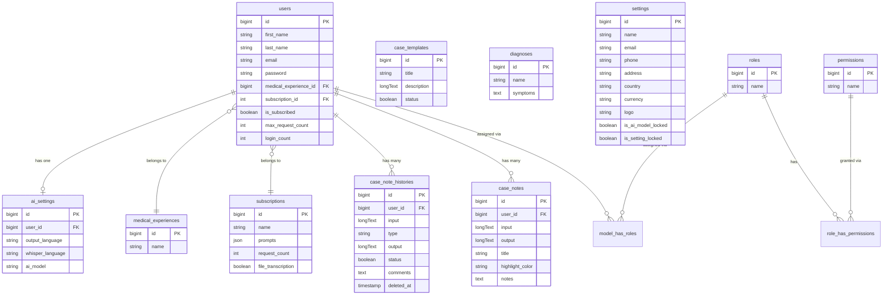

---

## 4. User Roles & Permissions

| Role | Description | Key Capabilities |
|---|---|---|
| **Super Admin** | Full system access | All permissions, manage users/roles/subscriptions/settings, view all histories |
| **Customer** | Registered healthcare professional | Access AICare, own case notes, own histories, limited by subscription |

**Permission-based navigation:**
- Admin sees: Dashboard, AICare, Transcription, Documents, AICare Store, Case Management (Histories + Templates), User Management (Users + Roles), Subscription, Settings
- Customer sees: AICare, Transcription, Visits Casenotes, Documents, AICare Store

---

## 5. Application Flow — Module by Module

### 5.1 Authentication Flow

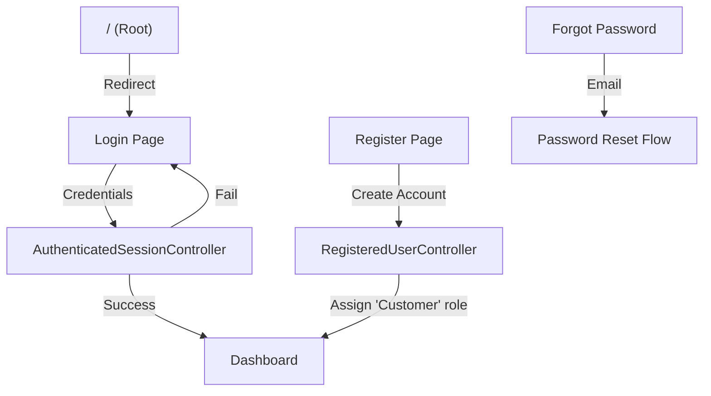

1. Root `/` redirects to `/login`
2. User registers with `first_name`, `last_name`, `email`, `password`, `mobile`, `country_code`, `medical_experience_id`
3. On registration, user gets `Customer` role with default permissions
4. An `AiSetting` record is created per user (default: English, GPT-4)
5. Login increments `login_count`

---

### 5.2 Dashboard Flow

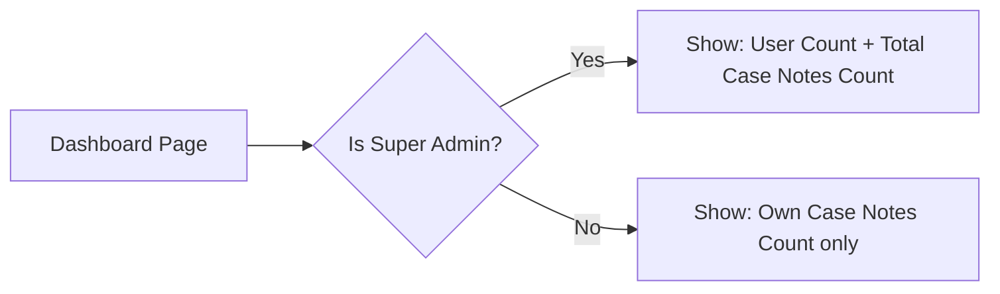

---

### 5.3 AICare — Core AI Generation Flow (★ Main Feature)

This is the **heart of the application**. The flow is:

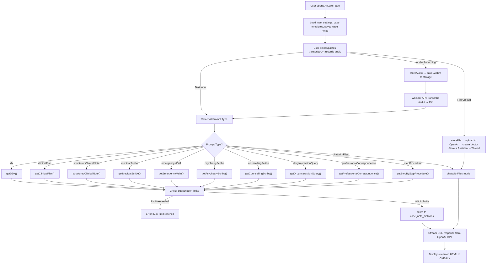

#### 5.3.1 AI Prompt Types (10 types)

| Type Key | Method | Description |
|---|---|---|
| `dx` | `getDDx()` | Differential Diagnosis — Most likely diagnosis, comprehensive case review, expanded differentials |
| `clinicalPlan` | `getClinicalPlan()` | Treatment Plan + Patient Education + Follow-up + Patient Letter |
| `structuredClinicalNote` | `structuredClinicalNote()` | Structured clinical note with diagnosis, case review, differentials |
| `medicalScribe` | `getMedicalScribe()` | Full SOAP note — Subjective, Objective, Assessment, Plan + Patient Follow-up |
| `emergencyMDM` | `getEmergencyMdm()` | Emergency Medical Decision Making — SUBJECTIVE, OBJECTIVE, EXAM, MDM NARRATIVE, Risk Details |
| `psychiatryScribe` | `getPsychiatryScribe()` | Psychiatric note — Mental Status Exam, Diagnosis, Treatment Plan |
| `counsellingScribe` | `getCounsellingScribe()` | Counselling note — MSE, Risk Assessment, Coping Mechanisms |
| `drugInteractionQuery` | `getDrugInteractionQuery()` | Drug interaction check — Adult/Children dosage, risks, interactions |
| `professionalCorrespondence` | `getProfessionalCorrespondence()` | Professional referral letter (≤150 words) |
| `stepProcedure` | `getStepByStepProcedure()` | Step-by-step surgical/medical procedure guide |
| `chatWithFiles` | `chatWithFiles()` | Upload document → OpenAI Assistants API → Q&A with file context |

#### 5.3.2 Audio Transcription Flow

Two transcription engines are supported:

**OpenAI Whisper:**
1. User records audio in browser → POST to `ai.audio.store`
2. Audio saved to `storage/app/public/audio/`
3. GET `ai.wisper` → sends audio file to Whisper API
4. Language configurable via `ai_settings.whisper_language`
5. Returns SSE stream of transcribed text segments

**AssemblyAI:**
1. Same audio upload step
2. GET `ai.assembly` → submits audio URL to AssemblyAI
3. Features: speaker diarization (Doctor/Patient), medical domain, PII redaction, language detection
4. Medical word boosting (500+ medical terms)
5. Polls for completion, then streams speaker-labeled utterances
6. Merges short utterances for accuracy

#### 5.3.3 Subscription/Rate Limiting Logic

```
IF user.role == 'Customer' AND user.subscription exists:
    IF case_notes_count > subscription.request_count → ERROR
ELSE IF user.role == 'Customer' AND no subscription:
    IF case_notes_count > 4 → ERROR (free tier default)
```

---

### 5.4 Case Notes (Transcriptions) Flow

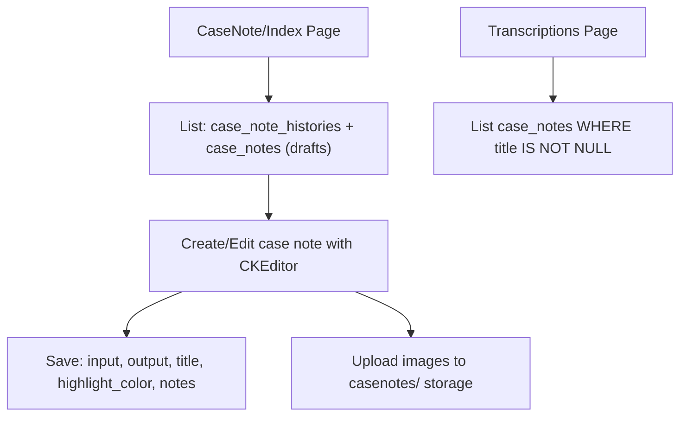

- **case_notes with title = NULL** are drafts/scratchpads
- **case_notes with title = NOT NULL** are saved transcriptions
- Case notes support rich text via CKEditor with image upload

---

### 5.5 Case Note Histories (AI Generation Log)

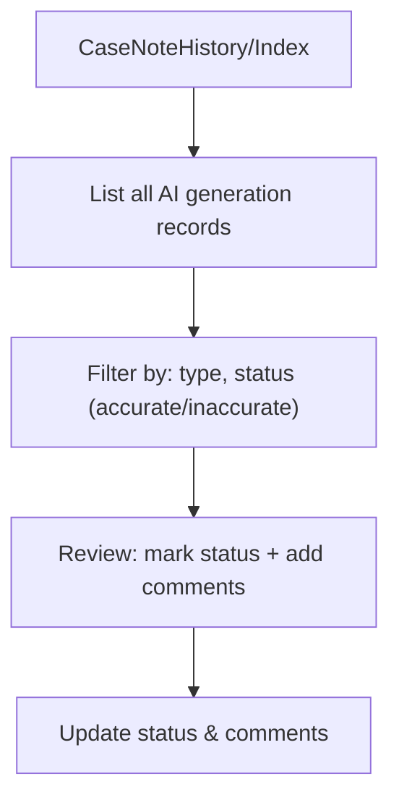

- Customers see only their own histories
- Admins see all histories
- Each history can be reviewed: `status` (boolean) + `comments`
- Soft-deletable

---

### 5.6 Case Templates (Admin)

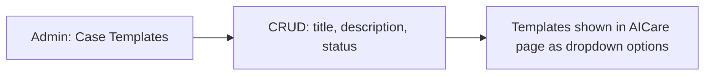

---

### 5.7 User Management (Admin)

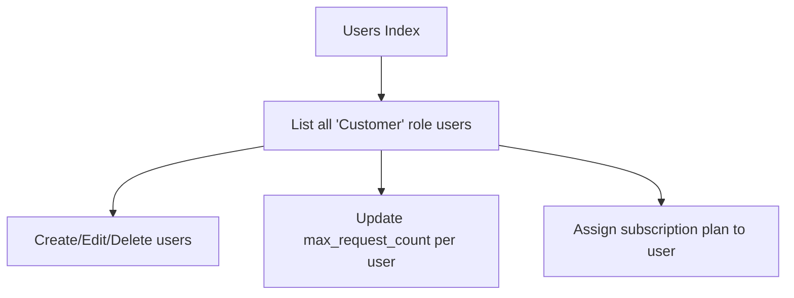

---

### 5.8 Role Management (Admin)

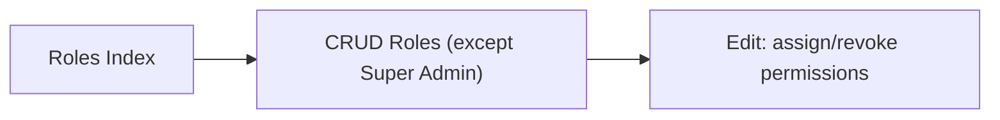

Permissions are auto-generated from route names using `RefreshPermissionsCommand`.

---

### 5.9 Subscription Management (Admin)

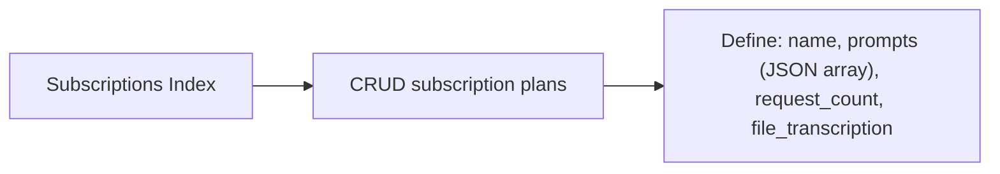

---

### 5.10 Settings (Admin)

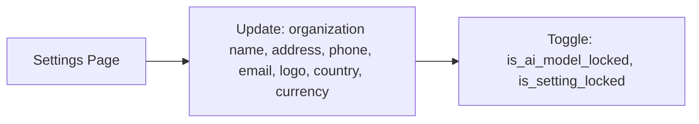

---

### 5.11 Diagnosis Lookup (API)

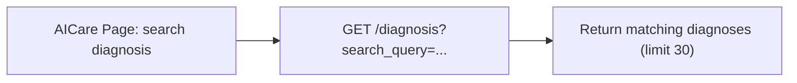

---

## 6. Frontend Pages Structure

```
resources/js/Pages/
├── AI/
│   └── Index.vue              ← Main AICare interface
├── Auth/
│   ├── Login.vue
│   ├── Register.vue
│   ├── ForgotPassword.vue
│   ├── ResetPassword.vue
│   └── ConfirmPassword.vue
├── CaseNote/
│   ├── Index.vue              ← Case notes list + editor
│   └── Transcription.vue      ← Saved transcriptions list
├── CaseNoteHistory/
│   └── Index.vue              ← AI generation history
├── CaseTemplate/
│   ├── Index.vue              ← Templates list
│   └── Create.vue             ← Create/Edit template
├── Dashboard.vue              ← Dashboard
├── Profile/
│   ├── Edit.vue
│   └── Partials/
├── Role/
│   ├── Index.vue              ← Roles list
│   └── Create.vue             ← Create/Edit role + permissions
├── Settings/
│   └── Index.vue              ← Global settings
├── Subscription/
│   ├── Index.vue              ← Subscription plans list
│   └── Create.vue             ← Create/Edit subscription
├── User/
│   ├── Index.vue              ← Users list
│   └── Create.vue             ← Create/Edit user
└── Welcome.vue
```

---

## 7. Environment Variables Required

```env
# App
APP_NAME=Ai-Care
APP_URL=http://localhost
APP_KEY=                           # Generate via: php artisan key:generate

# Database
DB_CONNECTION=mysql
DB_HOST=127.0.0.1
DB_PORT=3306
DB_DATABASE=aicare
DB_USERNAME=root
DB_PASSWORD=

# OpenAI
OPENAI_API_KEY=sk-xxxxx            # Required for GPT + Whisper
OPENAI_ORGANIZATION=org-xxxxx      # OpenAI org ID

# Aporia (Optional AI guardrail proxy)
ENABLE_APORIA=false
APORIA_BASE_URL=
APORIA_SECRET_KEY=

# AssemblyAI (Optional alternative transcription)
ASSEMBLYAI_API_KEY=
ASSEMBLYAI_ENDPOINT=https://api.assemblyai.com/v2/transcript
ASSEMBLYAI_POLLING_INTERVAL=3
ASSEMBLYAI_MAX_RETRY_ATTEMPTS=180
```

---

## 8. Step-by-Step Rebuild Guide

### Phase 1: Project Setup

```bash
# 1. Create Laravel 10 project
composer create-project laravel/laravel aicare "10.*"

# 2. Install PHP dependencies
composer require inertiajs/inertia-laravel:^0.6.8
composer require spatie/laravel-permission:^5.11
composer require openai-php/laravel:^0.10.2
composer require tightenco/ziggy:^1.0
composer require laravel/sanctum:^3.2
composer require barryvdh/laravel-dompdf:^2.0
composer require guzzlehttp/guzzle:^7.9
composer require maatwebsite/excel:^3.1

# 3. Install Laravel Breeze (Vue + Inertia)
composer require laravel/breeze --dev
php artisan breeze:install vue

# 4. Install JS dependencies
npm install pinia primevue@^3.49.1 vue-echarts echarts
npm install @ckeditor/ckeditor5-vue vue-select vue3-toastify
npm install jspdf jspdf-autotable @vuepic/vue-datepicker
```

### Phase 2: Database

```bash
# 1. Configure .env with MySQL credentials
# 2. Create migrations in this order:
```

**Migration Order:**
1. `medical_experiences` — name
2. `users` — with FK to medical_experiences
3. `password_reset_tokens`
4. `failed_jobs`
5. `personal_access_tokens`
6. `permission_tables` (via `php artisan vendor:publish --provider="Spatie\Permission\PermissionServiceProvider"`)
7. `settings` — organization settings
8. `ai_settings` — per-user AI config (FK users)
9. `case_note_histories` — AI generation log (FK users, soft deletes)
10. `diagnoses` — name, symptoms
11. `case_notes` — input, output, title, highlight_color, notes (FK users)
12. `case_templates` — title, description, status
13. `subscriptions` — name, prompts (JSON), request_count, file_transcription

```bash
php artisan migrate
php artisan db:seed
```

### Phase 3: Models

Create 9 models with the relationships documented in Section 2:

1. `User` — HasRoles trait, relationships to AiSetting, MedicalExperience, CaseNoteHistory, Subscription
2. `MedicalExperience` — simple lookup
3. `AiSetting` — belongsTo User
4. `CaseNoteHistory` — belongsTo User, SoftDeletes
5. `CaseNote` — belongsTo User
6. `CaseTemplate` — standalone
7. `Diagnosis` — standalone lookup
8. `Subscription` — prompts cast to array
9. `Settings` — appended logo_url, country cast to array

### Phase 4: Controllers & Services

**Controllers to build (12):**

| Controller | Responsibility |
|---|---|
| `AiController` | ★ Core — AI generation, audio upload, transcription, file chat |
| `CaseNoteController` | CRUD case notes, image upload, transcriptions list |
| `CaseNoteHistoryController` | List/review/delete AI generation histories |
| `CaseTemplateController` | CRUD case templates |
| `DashboardController` | Dashboard stats |
| `DiagnosisController` | Diagnosis search API |
| `UserController` | CRUD users, update subscription/max requests |
| `RoleController` | CRUD roles + permission assignment |
| `SubscriptionController` | CRUD subscription plans |
| `SettingsController` | Update global settings |
| `ProfileController` | Edit profile, change password |
| Auth Controllers | Login, Register, Password Reset (Breeze) |

**Services (3):**
- `RoleService` — Role CRUD logic
- `SubscriptionService` — Subscription CRUD + listing
- `DefaultCaseNoteService` — Default case note templates

### Phase 5: Routes

All routes require `auth` middleware. Key routes:

```php
// Dashboard
Route::get('dashboard', [DashboardController::class, 'index']);

// Settings
Route::get('settings', [SettingsController::class, 'index']);
Route::post('settings', [SettingsController::class, 'update']);

// User Management
Route::resource('users', UserController::class);
Route::post('users/update-max-request-count', ...);
Route::post('users/update-subscription', ...);

// Case Management
Route::resource('casenotes-histories', CaseNoteHistoryController::class);
Route::patch('casenotes-histories/{id}/status', ...);
Route::resource('casenotes', CaseNoteController::class);
Route::post('casenotes/imageUpload', ...);
Route::resource('case-templates', CaseTemplateController::class);

// AI Core
Route::get('ai-care', [AiController::class, 'index']);
Route::post('ai-care/store-audio', ...);
Route::post('ai-care/store-file', ...);
Route::get('ai-care/wisper', ...);
Route::get('ai-care/assembly', ...);
Route::get('ai-care/generate', ...);
Route::patch('ai-setting/{id}/update', ...);

// Other
Route::resource('roles', RoleController::class);
Route::resource('subscriptions', SubscriptionController::class);
Route::get('transcriptions', ...);
Route::get('diagnosis', ...);
```

### Phase 6: Frontend

1. Set up Inertia.js + Vue 3 with Pinia
2. Configure `HandleInertiaRequests` middleware to share: auth user, permissions, roles, settings, menus, CSRF
3. Build sidebar navigation based on role (admin vs customer)
4. Create page components matching the structure in Section 6
5. **AICare Page** is the most complex — requires:
   - Audio recording (MediaRecorder API)
   - SSE streaming (EventSource)
   - CKEditor integration for rich text display
   - Template/case note selector dropdowns
   - AI prompt type selector
   - File upload for chat-with-files mode

### Phase 7: Seeders

Run seeders in order:
1. `RefreshPermissionsCommand` — auto-generate permissions from routes
2. `UserTableSeeder` — create Super Admin users + roles
3. `SettingSeeder` — default organization settings
4. `MedicalExperienceSeeder` — 6 experience levels
5. `DiagnosisSeeder` — pre-populated diagnosis database
6. `SubscriptionSeeder` — default "Free" plan

---

## 9. Key Architectural Patterns

| Pattern | Implementation |
|---|---|
| **SSE Streaming** | AI responses streamed via Server-Sent Events (text/event-stream) with `<END_STREAMING_SSE>` sentinel |
| **Inertia.js SPA** | Server-side routing, client-side rendering — no separate API needed |
| **Role-based menus** | `HandleInertiaRequests` shares different menu structures for admin vs customer |
| **Permission auto-discovery** | `RefreshPermissionsCommand` scans route names to generate permissions |
| **Subscription gating** | AI generation checks user's case_notes_count against subscription.request_count |
| **Dual transcription** | OpenAI Whisper (simple/fast) + AssemblyAI (speaker diarization, medical domain) |
| **AI guardrail proxy** | Optional Aporia proxy for content safety filtering on OpenAI calls |
| **Soft deletes** | Only on `case_note_histories` for audit trail preservation |

---

## 10. Important Notes for Rebuild

> [!IMPORTANT]
> - The `menuAside.js` file contains **leftover routes** from a different project (Orders, Products, Brands, Categories, Reports). These are **NOT used** in AICare — the actual menus come from `HandleInertiaRequests.php`.
> - The `api.php` routes file imports `OrderController` and `ProductController` but has **no active routes** — these are legacy remnants.
> - All AI prompts include **HTML/CSS styling instructions** (class names like `heading__teal`, `heading__pink`, etc.) that the frontend renders in the CKEditor output area.
> - The `case_notes` table serves dual purpose: records with `title = NULL` are untitled drafts; records with titles are saved transcriptions.
> - OpenAI model is hardcoded to `gpt-5.4` in the controller (despite UI showing GPT-4 selection) — this should be made configurable.

> [!WARNING]
> - The `.env.example` contains **real API keys** — these should be rotated and replaced with placeholders before any public use.
> - The `storeFile` method creates OpenAI Assistants and Vector Stores but **never cleans them up** — this will accumulate costs over time.
