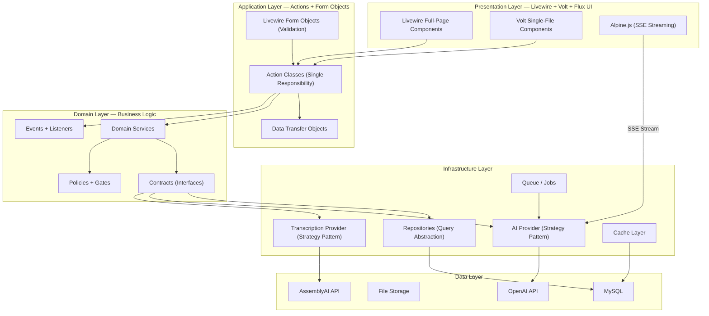

# AICare v2 — Rebuild Plan: Laravel 12 + Livewire 3

## Part 1: Architectural Flaws in the Current Codebase

### 🔴 Critical Flaws

| # | Flaw | Where | Impact |
|---|---|---|---|
| 1 | **God Controller** | [AiController.php](file:///Users/bibekshrestha/Developer/docspe/aicare/app/Http/Controllers/AiController.php) — **1,518 lines** | Untestable, unmaintainable. All AI logic, transcription, file handling, streaming, prompt templates crammed into one class. Violates Single Responsibility Principle. |
| 2 | **No Service Layer for Core Logic** | AI generation, subscription checks, prompt building — all in controller methods | Business logic is unreusable, untestable in isolation. Cannot swap implementations. |
| 3 | **Hardcoded AI Model** | Line 96: `'model' => 'gpt-5.4'` hardcoded despite `ai_settings.ai_model` existing per-user | User's AI model preference is ignored. Changing model requires code deploy. |
| 4 | **Prompt Injection Vulnerability** | `$input = strip_tags($request->input)` then directly interpolated into system prompts | Users can manipulate AI behavior by injecting instructions into the input field. `strip_tags()` does NOT prevent prompt injection. |
| 5 | **No OpenAI Resource Cleanup** | [storeFile()](file:///Users/bibekshrestha/Developer/docspe/aicare/app/Http/Controllers/AiController.php#L194-L266) creates Assistants + Vector Stores + Threads, never deletes them | Costs accumulate silently. OpenAI charges for stored vectors. Eventually hits account limits. |
| 6 | **Synchronous Heavy Operations** | `ini_set('max_execution_time', 120)`, AssemblyAI polling with `sleep()` in request cycle | Blocks PHP workers for 2+ minutes per request. Under load, the server runs out of workers and crashes. |
| 7 | **API Keys in `.env.example`** | [.env.example](file:///Users/bibekshrestha/Developer/docspe/aicare/.env.example#L61-L64) contains real `sk-` and `org-` keys | Anyone who clones the repo gets real API keys. Major security breach. |

### 🟡 Structural Flaws

| # | Flaw | Where | Impact |
|---|---|---|---|
| 8 | **Dual-Purpose Table** | `case_notes` uses `title = NULL` to mean "draft" vs. saved | Ambiguous queries, no explicit state machine. Cannot distinguish "intentionally untitled" from "draft". |
| 9 | **No DTOs / Value Objects** | Raw `$request->all()`, loose arrays everywhere | No type safety. Any typo silently passes. Impossible to refactor with confidence. |
| 10 | **No Caching** | Diagnosis search (30 queries/session), Settings (every request), Subscriptions | Unnecessary database hits. Settings are read on EVERY page load via `HandleInertiaRequests`. |
| 11 | **No Events / Listeners** | AI generation, user registration, status changes — no events fired | Cannot add audit logging, notifications, analytics, or webhooks without modifying core code. |
| 12 | **Business Logic in Middleware** | [HandleInertiaRequests.php](file:///Users/bibekshrestha/Developer/docspe/aicare/app/Http/Middleware/HandleInertiaRequests.php#L54-L170) — 110 lines of menu/permission logic | Middleware should be thin. Menu building is a presentation concern, not a request concern. |
| 13 | **Subscription Logic in Controller** | Rate-limit check is inline in `generateAiData()` | Cannot reuse for other endpoints. No policy/gate pattern. Easy to forget on new endpoints. |
| 14 | **Prompts as PHP Strings** | 10 massive prompt methods (100-200 lines each) with CSS class instructions embedded | Prompts are not versioned, not A/B testable, not editable by non-developers. CSS mixed with AI instructions. |
| 15 | **No Repository / Query Abstraction** | Direct `Model::query()` calls in controllers | Scattering query logic makes it impossible to optimize or swap data sources. |
| 16 | **Single-Row Settings Table** | `Settings::latest()->first()` everywhere | Not scalable for multi-tenancy. No audit trail. One accidental delete loses everything. |

### 🟠 Quality Flaws

| # | Flaw | Where | Impact |
|---|---|---|---|
| 17 | **Dead Code** | [menuAside.js](file:///Users/bibekshrestha/Developer/docspe/aicare/resources/js/menuAside.js) — Orders/Products/Brands routes; [api.php](file:///Users/bibekshrestha/Developer/docspe/aicare/routes/api.php) — imports unused controllers | Confusing for developers. Gives false impression of features. |
| 18 | **No Tests** | Zero test files | No confidence in changes. Regressions go unnoticed. |
| 19 | **No Rate Limiting Middleware** | AI endpoints have no throttle beyond subscription count | A single user can flood the AI endpoint with concurrent requests. |
| 20 | **No Error Boundaries** | Many methods have bare `try/catch` with generic messages | Users see unhelpful errors. Developers cannot debug production issues. |
| 21 | **No Database Indexes** | Only primary keys and the unique email index | Full-table scans on `case_note_histories` (which grows unbounded). |
| 22 | **No Logging / Observability** | Only AssemblyAI has `\Log::info()` calls | AI failures, slow queries, rate-limit hits — all invisible. |

---

## Part 2: Proposed Architecture — Domain-Driven Design

### High-Level Architecture



### Domain Boundaries (Bounded Contexts)

```
app/
├── Domain/
│   ├── AI/                          ← ★ Core AI generation domain
│   │   ├── Actions/
│   │   │   ├── GenerateClinicalNote.php
│   │   │   ├── StreamAiResponse.php
│   │   │   └── UpdateAiSettings.php
│   │   ├── Contracts/
│   │   │   ├── AiProviderInterface.php
│   │   │   └── PromptBuilderInterface.php
│   │   ├── DTOs/
│   │   │   ├── AiGenerationRequest.php
│   │   │   └── AiGenerationResult.php
│   │   ├── Enums/
│   │   │   └── PromptType.php          ← enum: dx, medicalScribe, etc.
│   │   ├── Events/
│   │   │   ├── AiGenerationStarted.php
│   │   │   ├── AiGenerationCompleted.php
│   │   │   └── AiGenerationFailed.php
│   │   ├── Models/
│   │   │   ├── AiSetting.php
│   │   │   └── GenerationHistory.php
│   │   ├── Prompts/                    ← Externalized prompt templates
│   │   │   ├── ddx.blade.php
│   │   │   ├── medical-scribe.blade.php
│   │   │   ├── psychiatry-scribe.blade.php
│   │   │   └── ...
│   │   ├── Providers/
│   │   │   ├── OpenAiProvider.php
│   │   │   └── AporiaProvider.php
│   │   └── Services/
│   │       ├── AiGenerationService.php
│   │       └── PromptBuilder.php
│   │
│   ├── CaseManagement/               ← Case notes, templates
│   │   ├── Actions/
│   │   ├── DTOs/
│   │   ├── Enums/
│   │   │   └── CaseNoteStatus.php     ← enum: draft, saved, archived
│   │   ├── Models/
│   │   │   ├── CaseNote.php
│   │   │   └── CaseTemplate.php
│   │   └── Services/
│   │
│   ├── Identity/                      ← Users, auth, roles
│   │   ├── Actions/
│   │   ├── Models/
│   │   │   ├── User.php
│   │   │   └── MedicalExperience.php
│   │   └── Policies/
│   │
│   ├── Subscription/                  ← Plans, limits, billing
│   │   ├── Actions/
│   │   ├── DTOs/
│   │   ├── Events/
│   │   ├── Models/
│   │   │   └── SubscriptionPlan.php
│   │   └── Services/
│   │       └── UsageLimiter.php       ← Rate limiting logic
│   │
│   ├── Transcription/                 ← Audio → text
│   │   ├── Actions/
│   │   ├── Contracts/
│   │   │   └── TranscriptionProviderInterface.php
│   │   ├── Jobs/
│   │   │   └── ProcessTranscription.php  ← Queued!
│   │   ├── Providers/
│   │   │   ├── WhisperProvider.php
│   │   │   └── AssemblyAiProvider.php
│   │   └── Services/
│   │
│   └── Administration/                ← Settings, diagnosis lookup
│       ├── Models/
│       │   ├── AppSettings.php
│       │   └── Diagnosis.php
│       └── Services/
│
├── Livewire/                          ← Presentation components
│   ├── AI/
│   │   ├── AiCarePage.php             ← Full-page component
│   │   ├── PromptSelector.php
│   │   ├── AudioRecorder.php
│   │   └── Forms/
│   │       └── AiSettingsForm.php
│   ├── CaseManagement/
│   ├── Dashboard/
│   ├── Settings/
│   ├── Subscriptions/
│   └── Users/
│
└── Providers/
    ├── AiServiceProvider.php          ← Bind interfaces → implementations
    └── AppServiceProvider.php
```

---

## Part 3: Technology Stack (New)

| Layer | Old Stack | New Stack | Why |
|---|---|---|---|
| **Framework** | Laravel 10 | **Laravel 12** | PHP 8.2+, streamlined structure, latest security |
| **Frontend** | Vue 3 + Inertia.js | **Livewire 3 + Volt + Alpine.js** | No JS framework overhead, native Laravel feel, simpler deployment |
| **UI Kit** | PrimeVue (Vue) | **Flux UI** (Livewire native) | Designed for Livewire, composable, Tailwind-native |
| **CSS** | Tailwind 3 | **Tailwind CSS 4** | Faster builds, CSS-first config |
| **Rich Text** | CKEditor 5 (custom build) | **TipTap (via Livewire)** or **CKEditor 5 CDN** | Lighter, better Alpine.js integration |
| **State** | Pinia (Vue) | **Livewire component state + Alpine** | No client-side store needed |
| **Streaming** | Raw SSE in controller | **SSE endpoint + Alpine.js consumer** | Clean separation: Livewire for state, Alpine for streaming |
| **Auth** | Laravel Breeze (Vue) | **Laravel Livewire Starter Kit** | Native Livewire auth scaffolding |
| **Testing** | None | **Pest PHP** | Modern, expressive, Laravel-native |
| **Monitoring** | None | **Laravel Pulse** | Real-time app monitoring |
| **Queue** | Sync | **Laravel Queue (database/Redis)** | Async transcription processing |

---

## Part 4: Redesigned Database Schema

### Key Changes from Current Schema

| Change | Reason |
|---|---|
| `case_notes.status` enum instead of `title IS NULL` | Explicit state, no ambiguity |
| `generation_histories` (renamed from `case_note_histories`) | Clearer naming |
| `generation_histories.prompt_type` as enum | Type safety, validation |
| `generation_histories.model_used` added | Track which AI model was actually used |
| `generation_histories.token_count` added | Usage tracking for billing |
| `generation_histories.duration_ms` added | Performance tracking |
| `ai_settings` gets `transcription_provider` field | Support provider switching |
| `subscription_plans` (renamed from `subscriptions`) | Clearer naming |
| `subscription_plans.features` JSON | Extensible feature flags |
| `app_settings` (renamed from `settings`) | Clearer naming |
| `prompt_templates` new table | Externalize prompts from code |
| Added database indexes on foreign keys and query columns | Performance |
| `transcription_jobs` new table | Track async transcription status |

### Complete New Schema

#### `users`

| Field | Type | Notes |
|---|---|---|
| `id` | bigint PK | — |
| `first_name` | string | required |
| `last_name` | string | nullable |
| `email` | string | unique |
| `email_verified_at` | timestamp | nullable |
| `password` | string | hashed |
| `country_code` | string(10) | nullable |
| `mobile` | string(20) | nullable |
| `medical_experience_id` | FK → `medical_experiences` | nullable, cascadeOnDelete |
| `subscription_plan_id` | FK → `subscription_plans` | nullable, nullOnDelete |
| `is_active` | boolean | default: true |
| `login_count` | integer | default: 0 |
| `last_login_at` | timestamp | nullable |
| `remember_token` | string | — |
| `created_at` | timestamp | — |
| `updated_at` | timestamp | — |

> [!IMPORTANT]
> Removed `is_subscribed` and `max_request_count` from users — these now come from the subscription plan relation. Single source of truth.

---

#### `medical_experiences`

| Field | Type |
|---|---|
| `id` | bigint PK |
| `name` | string |
| `sort_order` | integer, default: 0 |
| `timestamps` | — |

---

#### `ai_settings`

| Field | Type | Notes |
|---|---|---|
| `id` | bigint PK | — |
| `user_id` | FK → `users` | unique, cascadeOnDelete |
| `output_language` | string | default: 'English' |
| `whisper_language` | string(10) | default: 'en' |
| `ai_model` | string | default: 'gpt-4o' |
| `transcription_provider` | enum: `whisper`, `assemblyai` | default: 'whisper' |
| `timestamps` | — | — |

---

#### `generation_histories`

| Field | Type | Notes |
|---|---|---|
| `id` | bigint PK | — |
| `user_id` | FK → `users` | cascadeOnDelete, **indexed** |
| `prompt_type` | string (enum backed) | **indexed**. Values: `dx`, `clinical_plan`, `structured_clinical_note`, `medical_scribe`, `emergency_mdm`, `psychiatry_scribe`, `counselling_scribe`, `drug_interaction`, `professional_correspondence`, `step_procedure`, `chat_with_files` |
| `input` | longText | User's raw transcript/input |
| `output` | longText | nullable — filled after generation completes |
| `model_used` | string | e.g., 'gpt-4o' — actual model used |
| `token_count` | integer | nullable — input + output tokens |
| `duration_ms` | integer | nullable — generation time |
| `review_status` | enum: `pending`, `accurate`, `inaccurate` | default: 'pending' |
| `reviewer_comments` | text | nullable |
| `metadata` | json | nullable — extra context (temperature, seed, etc.) |
| `timestamps` | — | — |
| `deleted_at` | timestamp (soft delete) | — |

---

#### `case_notes`

| Field | Type | Notes |
|---|---|---|
| `id` | bigint PK | — |
| `user_id` | FK → `users` | cascadeOnDelete, **indexed** |
| `title` | string | nullable |
| `input` | longText | nullable — the transcript/text |
| `output` | longText | nullable — AI-generated content |
| `status` | enum: `draft`, `saved`, `archived` | default: 'draft', **indexed** |
| `highlight_color` | string(20) | nullable |
| `notes` | text | nullable |
| `timestamps` | — | — |

---

#### `case_templates`

| Field | Type | Notes |
|---|---|---|
| `id` | bigint PK | — |
| `title` | string | required |
| `description` | longText | nullable |
| `is_active` | boolean | default: true |
| `sort_order` | integer | default: 0 |
| `timestamps` | — | — |

---

#### `prompt_templates` ← NEW

| Field | Type | Notes |
|---|---|---|
| `id` | bigint PK | — |
| `prompt_type` | string (enum backed) | unique |
| `name` | string | Display name |
| `system_prompt` | longText | The prompt template (with `{{ $input }}`, `{{ $language }}` placeholders) |
| `styling_instructions` | longText | nullable — CSS class instructions separated from medical prompt |
| `is_active` | boolean | default: true |
| `version` | integer | default: 1 |
| `timestamps` | — | — |

> [!TIP]
> Separating prompts into a database table means admins can edit prompts from the UI, A/B test prompt versions, and roll back without code deploys.

---

#### `subscription_plans`

| Field | Type | Notes |
|---|---|---|
| `id` | bigint PK | — |
| `name` | string | required |
| `allowed_prompts` | json | Array of allowed `PromptType` values |
| `max_generations_per_month` | integer | nullable (null = unlimited) |
| `allow_file_transcription` | boolean | default: false |
| `allow_audio_transcription` | boolean | default: true |
| `max_audio_duration_seconds` | integer | nullable |
| `features` | json | nullable — extensible feature flags |
| `is_active` | boolean | default: true |
| `sort_order` | integer | default: 0 |
| `timestamps` | — | — |

---

#### `transcription_jobs` ← NEW

| Field | Type | Notes |
|---|---|---|
| `id` | bigint PK | — |
| `user_id` | FK → `users` | cascadeOnDelete |
| `provider` | enum: `whisper`, `assemblyai` | — |
| `audio_path` | string | Storage path |
| `status` | enum: `pending`, `processing`, `completed`, `failed` | default: 'pending' |
| `transcript_text` | longText | nullable — filled on completion |
| `external_id` | string | nullable — AssemblyAI transcript ID |
| `error_message` | text | nullable |
| `metadata` | json | nullable — confidence scores, speaker labels, etc. |
| `started_at` | timestamp | nullable |
| `completed_at` | timestamp | nullable |
| `timestamps` | — | — |

---

#### `diagnoses`

| Field | Type | Notes |
|---|---|---|
| `id` | bigint PK | — |
| `name` | string | **indexed** |
| `symptoms` | text | nullable |
| `timestamps` | — | — |

---

#### `app_settings`

| Field | Type | Notes |
|---|---|---|
| `id` | bigint PK | — |
| `key` | string | unique — e.g., 'organization_name', 'logo_path' |
| `value` | text | nullable |
| `group` | string | default: 'general' — for grouping in UI |
| `timestamps` | — | — |

> [!IMPORTANT]  
> Changed from single-row to key-value pattern. This is more flexible, safer (no single-row-delete risk), and cache-friendly.

---

## Part 5: Key Design Patterns

### 5.1 Strategy Pattern — AI Providers

```php
// Contract
interface AiProviderInterface
{
    public function streamChat(AiGenerationRequest $request): Generator;
    public function uploadFile(UploadedFile $file): FileUploadResult;
    public function cleanupResources(string $assistantId, string $vectorStoreId): void;
}

// Implementations
class OpenAiProvider implements AiProviderInterface { ... }
class AporiaProvider implements AiProviderInterface { ... }

// Bound in AiServiceProvider based on config
$this->app->bind(AiProviderInterface::class, function () {
    return config('ai.use_aporia')
        ? new AporiaProvider()
        : new OpenAiProvider();
});
```

### 5.2 Action Classes (Not Fat Controllers)

```php
// Instead of 1,518-line controller, each operation is an Action:
class GenerateClinicalNote
{
    public function __construct(
        private AiProviderInterface $ai,
        private PromptBuilder $promptBuilder,
        private UsageLimiter $limiter,
    ) {}

    public function execute(AiGenerationRequest $dto): StreamedResponse
    {
        // 1. Check usage limits
        $this->limiter->enforceOrFail($dto->user);

        // 2. Build prompt from template
        $prompt = $this->promptBuilder->build($dto->promptType, $dto->input, $dto->language);

        // 3. Record history
        $history = GenerationHistory::create([...]);

        // 4. Fire event
        AiGenerationStarted::dispatch($history);

        // 5. Stream response
        return $this->ai->streamChat($dto);
    }
}
```

### 5.3 Prompt Templates — Blade-Based

```blade
{{-- resources/views/prompts/medical-scribe.blade.php --}}
You are a highly skilled medical charting assistant.

The user will provide a transcript of a physician and patient visit.
Generate a comprehensive SOAP note in {{ $language }}.

Sections:
- Subjective: Chief Complaint, HPI, ROS
- Objective: Vital Signs, Physical Exam, Labs
- Assessment: Diagnosis, Clinical Impressions  
- Plan: Treatment, Patient Education, Follow-up

Formatting: Return as clean HTML with semantic headings.
Use <h3 class="section-heading"> for section titles.

CRITICAL: Only use information from the provided transcript.
Never fabricate information.
```

### 5.4 Livewire + Alpine.js SSE Streaming

```php
// Livewire component handles state
class AiCarePage extends Component
{
    public string $input = '';
    public string $promptType = 'medical_scribe';
    public bool $isGenerating = false;

    public function startGeneration(): void
    {
        $this->isGenerating = true;
        // Emit the stream URL to Alpine.js
        $this->dispatch('start-streaming', url: route('ai.stream', [
            'input' => $this->input,
            'type' => $this->promptType,
        ]));
    }

    public function saveResult(string $output): void
    {
        // Called by Alpine after stream completes
        GenerationHistory::where('id', $this->historyId)
            ->update(['output' => $output]);
        $this->isGenerating = false;
    }
}
```

```html
<!-- Alpine.js handles the SSE stream -->
<div x-data="aiStreamer()" @start-streaming.window="stream($event.detail.url)">
    <div x-html="output"></div>
</div>

<script>
function aiStreamer() {
    return {
        output: '',
        async stream(url) {
            const response = await fetch(url);
            const reader = response.body.getReader();
            const decoder = new TextDecoder();
            
            while (true) {
                const { done, value } = await reader.read();
                if (done) break;
                const text = decoder.decode(value);
                if (text.includes('<END_STREAMING_SSE>')) break;
                this.output += text;
            }
            
            // Notify Livewire that streaming is complete
            Livewire.dispatch('generation-complete', { output: this.output });
        }
    }
}
</script>
```

### 5.5 Queued Transcription (Not Blocking)

```php
// Instead of blocking for 2+ minutes:
class ProcessTranscription implements ShouldQueue
{
    public int $timeout = 600; // 10 minutes
    
    public function handle(TranscriptionProviderInterface $provider): void
    {
        $job = TranscriptionJob::find($this->jobId);
        $job->update(['status' => 'processing', 'started_at' => now()]);
        
        try {
            $result = $provider->transcribe($job->audio_path);
            $job->update([
                'status' => 'completed',
                'transcript_text' => $result->text,
                'metadata' => $result->metadata,
                'completed_at' => now(),
            ]);
            TranscriptionCompleted::dispatch($job);
        } catch (\Exception $e) {
            $job->update(['status' => 'failed', 'error_message' => $e->getMessage()]);
        }
    }
}
```

User sees real-time progress via Livewire polling or Laravel Echo.

---

## Part 6: Nine-Phase Implementation Plan

### Phase 1 — Project Scaffolding *(Day 1)*

- [ ] Create Laravel 12 project: `laravel new aicare --using=livewire`
- [ ] Verify: PHP 8.2+, Tailwind 4, Flux UI, Volt, Livewire 3
- [ ] Configure `.env` (MySQL, OpenAI, AssemblyAI) — **no real keys in `.env.example`**
- [ ] Install additional packages:
  ```
  composer require spatie/laravel-permission
  composer require openai-php/laravel
  composer require spatie/laravel-data    (DTOs)
  ```
- [ ] Set up Pest PHP for testing
- [ ] Set up Laravel Pulse for monitoring
- [ ] Configure queue driver (database or Redis)

---

### Phase 2 — Database & Models *(Days 2–3)*

- [ ] Create all migrations per the schema in Part 4 (with proper indexes)
- [ ] Create Eloquent models with:
  - Relationships
  - Casts (enums, json, hashed)
  - Scopes (e.g., `scopeForUser`, `scopeActive`)
  - Fillable/guarded
- [ ] Create Enums:
  - `PromptType` — all 11 AI prompt types
  - `CaseNoteStatus` — draft, saved, archived
  - `ReviewStatus` — pending, accurate, inaccurate
  - `TranscriptionStatus` — pending, processing, completed, failed
  - `TranscriptionProvider` — whisper, assemblyai
- [ ] Create Seeders:
  - `MedicalExperienceSeeder`
  - `DiagnosisSeeder`
  - `PromptTemplateSeeder` — externalized prompts
  - `SubscriptionPlanSeeder` — Free tier
  - `AppSettingsSeeder`
  - `RoleAndPermissionSeeder`
  - `AdminUserSeeder`
- [ ] Write migration tests (Pest)

---

### Phase 3 — Domain Services & Actions *(Days 4–6)*

**AI Domain:**
- [ ] `AiProviderInterface` + `OpenAiProvider` + `AporiaProvider`
- [ ] `PromptBuilder` — loads from `prompt_templates` table, renders Blade
- [ ] `GenerateClinicalNote` action
- [ ] `StreamAiResponse` action (SSE endpoint)
- [ ] `UpdateAiSettings` action
- [ ] Events: `AiGenerationStarted`, `AiGenerationCompleted`, `AiGenerationFailed`
- [ ] Listeners: log to `generation_histories`, update token counts

**Transcription Domain:**
- [ ] `TranscriptionProviderInterface` + `WhisperProvider` + `AssemblyAiProvider`
- [ ] `ProcessTranscription` queued job
- [ ] `TranscriptionCompleted` event + listener
- [ ] Audio upload action

**Subscription Domain:**
- [ ] `UsageLimiter` service — checks monthly generation count against plan limit
- [ ] `SubscriptionGate` — Laravel Gate for policy-based checks
- [ ] Middleware: `EnsureWithinUsageLimits`

**Identity Domain:**
- [ ] User registration action (creates AiSetting, assigns role)
- [ ] User policies (who can view/edit whom)

**Case Management Domain:**
- [ ] CaseNote CRUD actions
- [ ] CaseTemplate CRUD actions

**Administration Domain:**
- [ ] `AppSettingsService` — key-value CRUD with caching
- [ ] `DiagnosisSearchService` — cached search with database fallback

---

### Phase 4 — Livewire Pages: Auth & Layout *(Days 7–8)*

- [ ] Auth pages (from starter kit): Login, Register, Forgot Password, Reset Password
- [ ] Customize Register to include: `first_name`, `last_name`, `mobile`, `country_code`, `medical_experience_id`
- [ ] Main layout with:
  - Sidebar navigation (role-based, built from a `NavigationService`)
  - Top bar with user info
  - Flux UI components
  - `wire:navigate` for SPA-like transitions
- [ ] Dashboard page:
  - Admin: user count, total generations, recent activity
  - Customer: own generation count, plan usage meter

---

### Phase 5 — Livewire Pages: AICare Core *(Days 9–13)* ★

This is the most complex phase — the main AI feature.

- [ ] **AiCarePage** (full-page Livewire component):
  - Input area (text input / paste)
  - Prompt type selector (with descriptions)
  - Case template dropdown (load into input)
  - Saved case note dropdown (load into input)
  - AI settings sidebar (model, language, whisper language)
  - Generate button
- [ ] **AudioRecorder** component (Alpine.js MediaRecorder):
  - Record, stop, playback
  - Upload to server
  - Trigger transcription job
  - Show transcription progress (polling or Echo)
  - Fill input on completion
- [ ] **FileUploader** component:
  - Upload document
  - Create OpenAI Assistant + Vector Store
  - Chat-with-files mode
  - **Cleanup on component destroy**
- [ ] **AiStreamOutput** (Alpine.js):
  - SSE consumer
  - Real-time HTML rendering
  - Stop generation button (abort fetch)
  - Copy to clipboard
  - Export as PDF
  - Save to case note
- [ ] **SSE Streaming Controller** (thin — delegates to Action):
  ```php
  Route::get('ai/stream', [AiStreamController::class, 'stream'])
      ->middleware(['auth', 'throttle:ai']);
  ```
- [ ] **DiagnosisSearch** (Volt component):
  - Debounced search
  - Cached results

---

### Phase 6 — Livewire Pages: Case Management *(Days 14–15)*

- [ ] **Case Notes Index** — paginated, filterable by status
- [ ] **Case Note Editor** — TipTap or CKEditor, with image upload
- [ ] **Generation Histories Index** — paginated, filterable by type/status
- [ ] **History Review** — mark accurate/inaccurate + comments
- [ ] **Case Templates CRUD** — admin only
- [ ] **Transcriptions List** — saved transcriptions with details

---

### Phase 7 — Livewire Pages: Admin *(Days 16–18)*

- [ ] **Users Management** — list, create, edit, delete, assign plan
- [ ] **Role Management** — CRUD roles, assign permissions
- [ ] **Subscription Plans** — CRUD plans with feature flags
- [ ] **Prompt Template Editor** — edit prompts from UI, versioning
- [ ] **App Settings** — key-value editor, grouped by category
- [ ] **Dashboard Widgets** — generation stats, usage charts (ECharts or Flux charts)

---

### Phase 8 — Testing *(Days 19–21)*

- [ ] **Unit Tests:**
  - `PromptBuilder` renders correctly
  - `UsageLimiter` enforces limits
  - `AiGenerationRequest` DTO validation
  - All Enums
- [ ] **Feature Tests:**
  - Auth flow (register, login, password reset)
  - AI generation (mock OpenAI, verify history created)
  - Subscription enforcement
  - Case note CRUD
  - Role/permission guards
- [ ] **Livewire Component Tests:**
  - `AiCarePage` — form submission, validation
  - `AudioRecorder` — upload flow
  - Admin pages — CRUD operations
- [ ] **Browser Tests (Dusk — optional):**
  - Full AI generation flow
  - Audio recording and transcription

---

### Phase 9 — Production Readiness *(Days 22–24)*

- [ ] Rate limiting middleware on AI endpoints
- [ ] Laravel Pulse dashboard configured
- [ ] Proper error pages (403, 404, 500)
- [ ] Logging: structured logs for AI operations
- [ ] Cache warming for settings, diagnoses
- [ ] Queue worker setup (Supervisor config)
- [ ] Backup strategy for database
- [ ] Security audit:
  - No API keys in source
  - CSRF on all forms
  - Prompt injection mitigation (input sanitization + output validation)
  - File upload validation (type, size)
- [ ] Performance: 
  - Database indexes verified
  - N+1 query elimination (eager loading)
  - Response caching where appropriate

---

## Part 7: Migration Checklist (Old → New)

| Old | New | Action |
|---|---|---|
| `case_note_histories` | `generation_histories` | Rename + add `model_used`, `token_count`, `duration_ms`, `metadata`. Rename `status` → `review_status`, `comments` → `reviewer_comments` |
| `case_notes.title IS NULL` | `case_notes.status = 'draft'` | Add `status` enum column, migrate data |
| `subscriptions` | `subscription_plans` | Rename + add `max_generations_per_month`, `features`, `allow_audio_transcription`, `max_audio_duration_seconds` |
| `users.max_request_count` | Removed (from `subscription_plans`) | Migrate existing values to plans |
| `users.is_subscribed` | Removed (derived from `subscription_plan_id IS NOT NULL`) | Drop column |
| `settings` (single row) | `app_settings` (key-value) | Convert each column to a key-value row |
| AI prompts in PHP code | `prompt_templates` table | Extract all 10 prompts into seeder |
| — | `transcription_jobs` | New table for async tracking |

---

## Open Questions

> [!IMPORTANT]
> **These need your input before Phase 1:**

1. **Multi-tenancy?** — Should different clinics/organizations have separate data, or is this single-tenant? This affects whether we add `organization_id` to most tables.

2. **Payment integration?** — The current system has subscription plans but no payment. Do you want Stripe/payment integration, or is plan assignment still manual (admin assigns)?

3. **Rich text editor choice?** — CKEditor 5 (familiar, heavy) vs. TipTap (lighter, better Alpine.js integration) vs. Quill? The current custom CKEditor build is complex.

4. **Real-time transcription progress?** — Should we use Livewire polling (simple, ~2s delay) or Laravel Reverb/Echo (WebSockets, instant)? Polling is simpler; WebSockets are better UX.

5. **Prompt management?** — Should admins be able to edit AI prompts from the UI (database-driven), or should prompts stay in Blade templates (developer-managed)? Database is more flexible but riskier.

6. **Data migration?** — Do you need to migrate existing data from the old MySQL database, or is this a completely fresh start?
